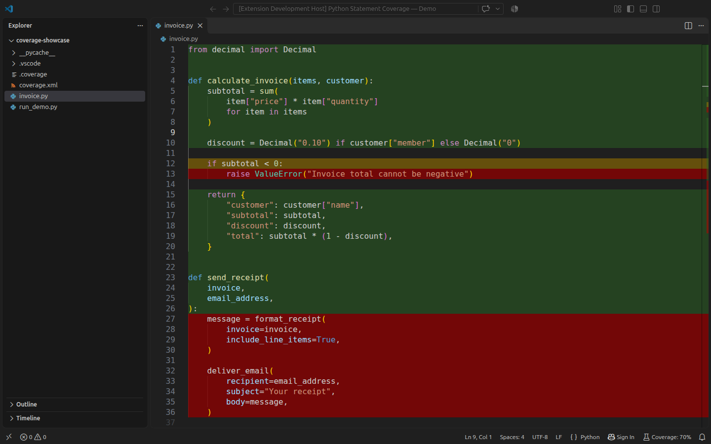
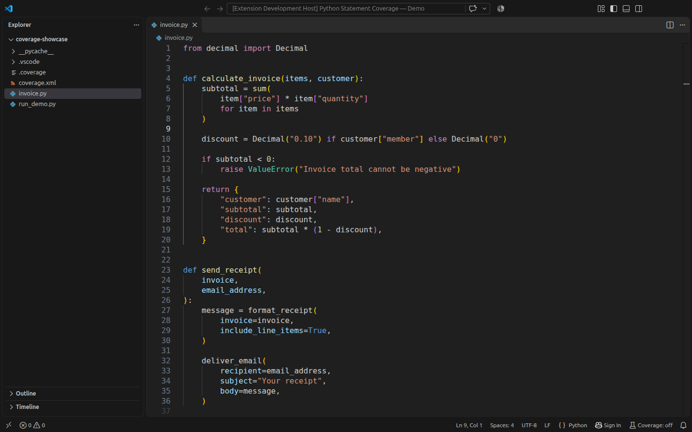

# Python Statement Coverage

PyCharm-style coverage backgrounds for **complete Python statements** in VS Code.
Multi-line calls, dictionaries, lists and function signatures are highlighted as a whole,
instead of leaving gaps on continuation lines omitted from coverage.py reports.

## Features

- Green for covered statements, red for uncovered statements, amber for partially covered branches.
- Continuous backgrounds across multi-line expressions.
- Blank lines between statements with the same coverage state inherit that color.
- Automatic refresh when the XML report changes.
- Status bar percentage and one-click show/hide toggle.
- Unsaved files and files saved after the report are hidden to avoid stale line mappings.
- Original report statistics remain unchanged: extra display lines do not inflate coverage.
- No runtime npm dependencies, telemetry, network uploads or project-code imports.

## Screenshots

Real VS Code screenshots from a small demo measured with coverage.py.
The demo includes covered statements, a partially covered branch and uncovered calls.



Click the status-bar coverage indicator to hide the backgrounds:



## Install

Download the `.vsix` from [GitHub Releases](https://github.com/Toximiner/python-statement-coverage/releases/latest)
and run **Extensions: Install from VSIX…** in VS Code.

You can also build an installable VSIX from this repository:

```sh
npm ci
npm run package
code --install-extension python-statement-coverage-0.1.1.vsix
```

Alternatively, download the `extension-vsix` artifact from a successful GitHub Actions run,
unzip it, and use **Extensions: Install from VSIX…** in VS Code.
Reload the VS Code window after installing or updating the extension.

The extension is installed locally; it is not published in Visual Studio Marketplace.
Marketplace publisher: `Toximiner`. Automatic publication is prepared; the listing becomes available after the first successful Marketplace publish. See [publishing setup](docs/PUBLISHING.md).

## Generate coverage

Install coverage tooling in your project's Python environment:

```sh
python -m pip install pytest pytest-cov
python -m pytest tests --cov=your_package --cov-branch --cov-report=xml:coverage.xml
```

Replace `tests` and `your_package` with your test directory and source package.
The extension checks `.vscode/coverage.xml`, then `coverage.xml` in the workspace root.

For VS Code's Python **Run with Coverage** action, add an XML reporter to your existing
test arguments, for example:

```json
{
  "python.testing.pytestEnabled": true,
  "python.testing.pytestArgs": ["tests", "--cov-report=xml:coverage.xml"]
}
```

The Python extension enables measurement for **Run with Coverage**. The reporter argument
alone does not enable coverage for ordinary test runs.

Disable other coverage highlighters in this workspace and hide VS Code's built-in
coverage overlay if backgrounds overlap.

## Show or hide coverage

Click **Coverage: …%** in the status bar, or run
**Python Statement Coverage: Toggle** from the Command Palette.
The choice is saved in workspace settings.
Closing VS Code's Test Coverage panel does not turn this extension's highlighting off.

Other commands:

- **Python Statement Coverage: Refresh** — re-read the report.
- **Python Statement Coverage: Show Output** — display analyzer errors.

## Settings

All settings use the `pythonStatementCoverage.` prefix.

| Setting | Default | Purpose |
| --- | --- | --- |
| `enabled` | `true` | Show coverage backgrounds. |
| `reportPath` | `.vscode/coverage.xml` | Absolute path or path relative to the workspace folder. The default falls back to root `coverage.xml`. |
| `pythonPath` | empty | Python executable; auto-detects `.venv`, `python.defaultInterpreterPath`, then system Python. |
| `fillBlankLines` | `true` | Fill whitespace-only gaps between equally colored statements. |
| `hideStale` | `true` | Hide files saved after report generation. Unsaved files are always hidden. |
| `showRuler` | `true` | Show coverage markers in the overview ruler. |
| `coveredColor` | `rgba(45, 100, 35, 0.5)` | Covered background. |
| `uncoveredColor` | `rgba(180, 0, 0, 0.55)` | Uncovered background. |
| `partialColor` | `rgba(180, 135, 0, 0.45)` | Partial branch background. |

## How it works and limitations

The analyzer reads a Cobertura XML report and uses Python's standard-library `tokenize`
module to find logical statement boundaries. A continuation line inherits the measured
statement's state. Explicit report entries always take priority. Hovering over a highlight
shows the original report line. It does not mean each continuation line was measured separately.

This approximates PyCharm's visual presentation; it does not reproduce its coverage engine.
In particular, a covered `def` line indicates that the function was defined, not that its
body ran. Comments and unmeasured statements between measured statements are not filled.
Whitespace gaps between different states stay unpainted.

Reports must resolve to local source paths. Container/remote path remapping is not yet
implemented. The extension supports trusted, filesystem-backed workspaces, not browser-only
VS Code. It runs a Python subprocess to analyze reports and never executes test or source code.

Runtime requirements: VS Code 1.85 or later and Python 3.9 or later.
Node.js and npm are only needed to develop or package the extension.

## Development

Use Node.js 22 or later, Python 3.9 or later, and npm:

```sh
npm ci
npm run check
npm test
npm run package
```

Tests cover statement expansion, branch states, blank-line filling, exact path matching,
stale/missing reports, unchanged statistics and editor integration through a mocked VS Code API.
The editor integration test invokes the real Python analyzer; it is not a visual UI test.
GitHub Actions runs these checks and uploads the VSIX as a build artifact. Version tags publish a GitHub Release with the VSIX and checksum. See [release and Marketplace publishing](docs/PUBLISHING.md).

## License

MIT. See [LICENSE](LICENSE).
